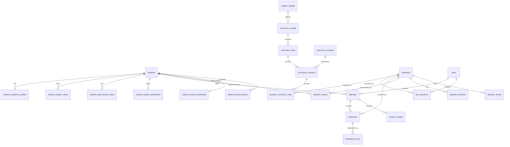

# Improvia Database Schema and Architecture Reference

> **Status:** Architecture reference and design proposal  
> **Reviewed branch:** `fix/student-auth-private-uploads`  
> **Reviewed commit:** `8d5495ab09339c80358757689ac0dd2af6dc316f`  
> **Last repository review:** 16 November 2026  
> **Scope:** Existing schema, migration reconciliation, multi-subject design, assessment history, platform events, analytics, performance, privacy and future database initialization.

This document is deliberately explicit about what exists today and what is only proposed. It is not a migration script and does not authorize database changes. Verify the repository at the target commit before using this document to operate a database.

## 1. Executive summary

Improvia currently uses Python, Flask, SQLAlchemy and MySQL/InnoDB. Its schema has foundations for student registration, subject enrolment, curriculum mapping, question-bank provenance, assessments, attempts, responses, evaluation, payments and student performance summaries.

The platform is intended to launch with Mathematics content while allowing other subjects, boards, classes and academic years to be added without redesigning the core data model. The current curriculum taxonomy is already multi-subject: version `2026.27.7` describes 8 subject identities, 21 curricula, 103 units and 236 official chapter entries. This is schema/taxonomy coverage, not proof that complete question banks, assessments or teaching content are ready for every subject.

The most important architecture gaps to address before commercial scale are:

1. The application bootstrap and migration scripts do not yet form one fully reconciled fresh-install process.
2. Student subject enrolment is modelled separately, but legacy single-subject fields and registration code still exist.
3. Attempts and responses are stored, but test/question content and evaluation details can be updated in place. Historical results therefore need immutable assessment/question context.
4. `question_history` is a derived aggregate, not a complete event or attempt history.
5. No unified `platform_events` table is currently implemented.
6. `MySQLStorage._load_cache()` loads whole operational tables into process memory; this should be progressively replaced with bounded database queries.
7. The production schema guard checks selected required tables/columns, not every schema property.

## 2. Source of truth and review method

The following repository files were reviewed read-only:

- `database.py` — primary schema bootstrap and production schema guard.
- `question_bank/migrations/001_question_bank_foundation.sql` — question provenance and extraction foundation.
- `question_bank/migrations/002_canonical_question_ingestion.sql` — canonical question solution/version support.
- `question_bank/migrations/005_curriculum_question_reuse.py` and `005_curriculum_question_reuse_audit.py` — curriculum model and data seeding/audit.
- `question_bank/migrations/006_exam_monitoring_mode.py` — monitoring mode compatibility migration.
- `question_bank/migrations/007_student_access.py` — student credentials and activation tokens.
- `curriculum_taxonomy_2026_27.json` — current curriculum taxonomy.
- `exam_platform/storage.py`, `evaluation.py`, `student_profile.py`, and `question_selection.py` — persistence and analytics access patterns.
- `docs/CURRICULUM_AND_QUESTION_REUSE.md`, `AGENTS.md`, and `docs/CHATGPT_INSTRUCTIONS.md` — existing design and operational constraints.

No database was connected to, queried, migrated or modified for this documentation review. No test suite was run as part of this documentation-only change.

### 2.1 Counting the schema

The primary `database.py` bootstrap contains 29 table definitions. Migration 001 defines `schema_migrations` plus 10 additional question-source/extraction tables. Migration 007 defines two student-access tables. Migrations 002, 004, 005 and 006 overlap parts of the bootstrap schema or add/repair columns; they must not be counted as wholly additional table sets.

The resulting code-level inventory is **42 distinct table names** when the 29 bootstrap tables, migration 001's 11 tables and migration 007's 2 tables are combined. This is an inventory of definitions across repository files, not a verified count of tables in any live database.

## 3. Existing schema inventory

The schema uses MySQL/InnoDB and `utf8mb4`. Column names and types below describe the definitions inspected in `database.py` and the migration files. Defaults and constraints should be checked against the exact DDL before writing SQL or changing a migration.

### 3.1 Student identity and learning context

#### `students` — primary student identity

- Columns: `student_id VARCHAR(32)` (primary key), `name VARCHAR(150)`, `email VARCHAR(255)`, `phone VARCHAR(30)`, `city VARCHAR(100)`, `role VARCHAR(30)`, `class_level INT`, `board VARCHAR(30)`, `subject VARCHAR(100)`, `school VARCHAR(255)`, `registration_date DATE`, `registration_source VARCHAR(100)`, `status VARCHAR(30)`, `created_at DATETIME`, `updated_at DATETIME`.
- Constraints/indexes: primary key on `student_id`; unique key `uq_students_email(email)`.
- Purpose: one identity/account record per student.
- Compatibility note: `subject` is a legacy single-subject attribute. It must not become the long-term authoritative multi-subject relationship.

#### `student_academic_profiles` — recorded study context

- Columns: `profile_id BIGINT AUTO_INCREMENT` (primary key), `student_id VARCHAR(32)`, `study_hours_per_week DECIMAL(5,2)`, `preparation_level VARCHAR(100)`, `current_study_methods_json TEXT`, `completed_chapters_json TEXT`, `current_chapter VARCHAR(150)`, `most_difficult_chapter VARCHAR(150)`, `improvement_areas_json TEXT`, `recorded_at DATETIME`.
- FK: `student_id → students.student_id ON DELETE CASCADE`.
- Index: `idx_profile_student(student_id)`.
- Purpose: point-in-time academic/profile information. The recorded timestamp permits multiple records.

#### `student_chapter_status` — chapter status records

- Columns: `id BIGINT AUTO_INCREMENT` (primary key), `student_id VARCHAR(32)`, `chapter VARCHAR(150)`, `status VARCHAR(30)`, `board VARCHAR(30)`, `class_level INT`, `recorded_at DATETIME`.
- FK: `student_id → students.student_id ON DELETE CASCADE`.
- Index: `idx_chapter_student(student_id, chapter)`.
- Note: the chapter is currently stored as text rather than a curriculum chapter foreign key.

#### `student_improvement_areas` — identified improvement areas

- Columns: `id BIGINT AUTO_INCREMENT` (primary key), `student_id VARCHAR(32)`, `area VARCHAR(150)`, `priority INT`, `recorded_at DATETIME`.
- FK: `student_id → students.student_id ON DELETE CASCADE`.
- Index: `idx_area_student(student_id, area)`.

#### `student_subject_enrollments` — multi-subject enrolment

- Columns: `enrollment_id BIGINT AUTO_INCREMENT` (primary key), `student_id VARCHAR(32)`, `board VARCHAR(20)`, `class_level INT`, `subject_id VARCHAR(80)`, `subject_code VARCHAR(30)`, `academic_year VARCHAR(20)`, `status VARCHAR(30)`, `created_at DATETIME`, `updated_at DATETIME`.
- FKs: `student_id → students.student_id ON DELETE CASCADE`; `subject_id → subject_catalog.subject_id`.
- Unique key: `uq_student_enrollment(student_id, board, class_level, subject_id, academic_year)`.
- Index: `idx_active_enrollment(student_id, status, board, class_level, subject_id)`.
- Purpose: one student can enrol in multiple subjects and academic contexts.
- Current implementation limitation: registration currently creates/upserts a mapped enrolment from a single `Student.subject` value; the helper has a hardcoded `2026-27` academic year and a finite subject mapping.

### 3.2 Subject and curriculum model

#### `subjects` — legacy subject lookup

- Columns: `subject_id VARCHAR(40)` (primary key), `name VARCHAR(100)` (unique), `active BOOLEAN`.
- Purpose: legacy chapter/competency lookup. Keep until all consumers are migrated and verified.

#### `subject_catalog` — canonical subject identities

- Columns: `subject_id VARCHAR(80)` (primary key), `subject_name VARCHAR(150)`, `subject_code VARCHAR(30)`, `active BOOLEAN`.
- Unique key: `uq_subject_catalog_name_code(subject_name, subject_code)`.
- Purpose: normalized subject identities, including board-specific subject codes where relevant.

#### `curriculum_catalog` — board/class/subject/year combination

- Columns: `curriculum_id VARCHAR(120)` (primary key), `board VARCHAR(20)`, `class_level INT`, `subject_id VARCHAR(80)`, `subject_code VARCHAR(30)`, `academic_year VARCHAR(20)`, `status VARCHAR(30)`.
- FK: `subject_id → subject_catalog.subject_id`.
- Unique key: `uq_curriculum(board, class_level, subject_id, academic_year)`.

#### `curriculum_units` — ordered syllabus units

- Columns: `unit_id VARCHAR(150)` (primary key), `curriculum_id VARCHAR(120)`, `unit_order INT`, `unit_name VARCHAR(255)`.
- FK: `curriculum_id → curriculum_catalog.curriculum_id ON DELETE CASCADE`.
- Unique key: `uq_curriculum_unit(curriculum_id, unit_order)`.

#### `canonical_concepts` — subject-scoped concept identity

- Columns: `concept_id VARCHAR(100)` (primary key), `concept_name VARCHAR(200)`, `subject_id VARCHAR(80)`, `active BOOLEAN`.
- FK: `subject_id → subject_catalog.subject_id`.
- Purpose: a stable analytics/concept label. Equal chapter names alone do not establish equivalence across subjects.

#### `curriculum_chapters` — official chapter entries

- Columns: `curriculum_chapter_id VARCHAR(180)` (primary key), `unit_id VARCHAR(150)`, `chapter_order INT`, `official_chapter_name VARCHAR(255)`, `canonical_concept_id VARCHAR(100)`, `status VARCHAR(30)`.
- FKs: `unit_id → curriculum_units.unit_id ON DELETE CASCADE`; `canonical_concept_id → canonical_concepts.concept_id`.
- Unique key: `uq_curriculum_chapter(unit_id, chapter_order)`.
- Index: `idx_curriculum_chapter_lookup(official_chapter_name)`.

#### `question_curriculum_map` — question applicability

- Columns: `question_id VARCHAR(40)`, `curriculum_chapter_id VARCHAR(180)`, `compatibility_status VARCHAR(30)`, `notes TEXT`, `reviewed_by VARCHAR(100)`, `reviewed_at DATETIME`.
- Composite primary key: `(question_id, curriculum_chapter_id)`.
- FKs: question and curriculum chapter; both cascade on delete.
- Index: `idx_qcm_status(compatibility_status)`.
- Compatibility statuses described by the existing curriculum documentation include `EXACT`, `CONCEPT_MATCH`, `BOARD_SPECIFIC` and `REVIEW_REQUIRED`. Review-required mappings must not be silently treated as approved reuse.

#### `chapters` and `competencies` — legacy lookup tables

- `chapters`: `chapter_id VARCHAR(60)` PK, `board VARCHAR(30)`, `class_level INT`, `subject_id VARCHAR(40)`, `chapter_name VARCHAR(150)`, `sort_order INT`, `active BOOLEAN`; FK to `subjects.subject_id`; unique key on `(board, class_level, subject_id, chapter_name)`.
- `competencies`: `competency_id VARCHAR(60)` PK, `subject_id VARCHAR(40)`, `name VARCHAR(150)`, `description VARCHAR(500)`, `sort_order INT`, `active BOOLEAN`; FK to `subjects.subject_id`; unique key on `(subject_id, name)`.
- Current code still uses these as fallback/lookup paths. Do not drop them until usage is removed and verified.

### 3.3 Question bank and content provenance

#### `questions` — canonical question record

- Columns: `question_id VARCHAR(40)` (primary key), `subject VARCHAR(100)`, `board VARCHAR(30)`, `class_level INT`, `chapter VARCHAR(150)`, `topic VARCHAR(150)`, `subtopic VARCHAR(150)`, `question_type VARCHAR(40)`, `answer_mode VARCHAR(80)`, `difficulty VARCHAR(50)`, `competency VARCHAR(100)`, `question_content_json LONGTEXT`, `answer_choices_json LONGTEXT`, `correct_answer VARCHAR(255)`, `marks DECIMAL(10,2)`, `handwritten_upload_mode VARCHAR(20)`, `source VARCHAR(255)`, `source_year INT`, `status VARCHAR(20)`, `source_type VARCHAR(20)`, `verification_status VARCHAR(30)`, `canonical_question_id VARCHAR(40)`, `created_at DATETIME`, `updated_at DATETIME`.
- Purpose: canonical reusable question payload and metadata.
- Important limitation: storage upserts update content and answer fields under an existing question ID. The current row is not an immutable historical version.

#### `question_solutions` — solution and marking-scheme versions

- Columns: `question_solution_id BIGINT AUTO_INCREMENT` (primary key), `question_id VARCHAR(40)`, `solution_content LONGTEXT`, `marking_scheme LONGTEXT`, `version INT`, `verified BOOLEAN`, `source_type VARCHAR(30)`, `created_at DATETIME`, `updated_at DATETIME`.
- FK: question, cascade on delete.
- Unique key: `uq_question_solution_version(question_id, version)`; index `idx_question_solution_question(question_id)`.
- The schema permits multiple versions, but storage upsert uses a supplied version and updates that version's content. Version numbering alone does not guarantee immutability.

#### `question_assets` — question media

- Columns: `asset_id VARCHAR(50)` (primary key), `question_id VARCHAR(40)`, `asset_type VARCHAR(30)`, `original_filename VARCHAR(255)`, `file_path TEXT`, `created_at DATETIME`.
- FK: question, cascade on delete.
- Index: `idx_question_assets(question_id)`.
- Migration 001 adds optional `page_number`, `bbox_json`, `asset_role`, `source_asset_id` and index `idx_question_asset_page(question_id, page_number)` on installations where missing.

#### `extraction_review_batches` and `extraction_review_items` — review staging

- `extraction_review_batches`: `batch_id VARCHAR(80)` PK, `filename VARCHAR(255)`, `payload_json LONGTEXT`, `created_at DATETIME`, `updated_at DATETIME`.
- `extraction_review_items`: `item_id VARCHAR(100)` PK, `batch_id VARCHAR(80)`, `question_index INT`, `question_json LONGTEXT`, `status VARCHAR(30)`, `note TEXT`, `question_id VARCHAR(40)`, `extraction_snapshot_json LONGTEXT`, `human_verified_values_json LONGTEXT`, timestamps.
- FKs: batch with cascade delete; optional question with `ON DELETE SET NULL`.
- Indexes: `idx_extraction_review_batch(batch_id)`, `idx_extraction_review_status(status)`.

#### Migration 001 question-source/extraction tables

These tables are defined by `question_bank/migrations/001_question_bank_foundation.sql`; they are not all created by the primary `database.py` bootstrap.

| Table | Purpose and principal columns | Keys / indexes |
|---|---|---|
| `schema_migrations` | `migration_id VARCHAR(100)`, `applied_at DATETIME` | PK `migration_id` |
| `source_papers` | `source_id`, filename, board, class, subject, paper year/set/code, file path, page count, status, timestamps | PK; metadata index on board/class/subject/year |
| `question_occurrences` | occurrence ID, question ID, source ID, original question number/label, page range, bounding-box JSON, created time | PK; FKs to question/source; unique source occurrence; indexes by source and question |
| `question_groups` | group ID, optional source ID, group type, context JSON, created time | PK; FK to source; source index |
| `question_parts` | part ID, optional group and parent question, question ID, part label, choice metadata, sequence, created time | PK; FKs to group and questions; indexes by group and parent |
| `question_extraction_runs` | run ID, source ID, page, provider/model, prompt/preprocessing versions, status, token usage, start/end times, error | PK; FK to source; indexes by source/provider |
| `question_extraction_results` | result ID, run ID, optional question ID, page, raw/normalized output, text/math/boundary/asset confidence, status, created time | PK; FKs to run/question; indexes by run/question |
| `question_verifications` | verification ID, question ID, optional extraction result, status, original/corrected output, reviewer/comments, verification and created times | PK; FKs to question/result; indexes by question/status |
| `extraction_jobs` | job ID, source ID, page, status, attempt count, provider, timestamps, error | PK; FK to source; unique source/page; status index |
| `extraction_providers` | provider ID/name/model, free/billing status, daily/monthly/RPM/TPM limits, verification source/time, active flag, timestamps | PK; unique provider/model |
| `extraction_feedback` | feedback ID, extraction result, error type, original/corrected value, reviewer, created time | PK; FK to result; indexes by result/error type |

The exact SQL types, nullability and defaults for these tables are in migration 001 and remain authoritative until this reference is updated from a later migration.

### 3.4 Assessments and student work

#### `tests` — assessment metadata

- Columns: `test_id VARCHAR(40)` PK, `title VARCHAR(255)`, `subject VARCHAR(100)`, `class_level INT`, `board VARCHAR(30)`, `test_date DATE`, `duration_minutes INT`, `total_marks DECIMAL(10,2)`, `test_type VARCHAR(50)`, `status VARCHAR(30)`, `monitoring_mode VARCHAR(20)`, `questions_json LONGTEXT`, `created_at DATETIME`.
- Note: current storage upsert can update test metadata and question membership. `test_questions` is a relational association, but the current `tests` record is not a versioned immutable assessment.

#### `test_questions` — ordered assessment composition

- Columns: `test_id VARCHAR(40)`, `question_id VARCHAR(40)`, `sequence_number INT`, `marks DECIMAL(10,2)`.
- Composite PK `(test_id, question_id)`; unique key `uq_test_sequence(test_id, sequence_number)`.
- FKs: test with cascade delete; question.

#### `attempts` — student attempt lifecycle and result summary

- Columns: `attempt_id VARCHAR(50)` PK, `student_id VARCHAR(32)`, `test_id VARCHAR(40)`, `started_at DATETIME`, `submitted_at DATETIME`, `status VARCHAR(30)`, `score DECIMAL(10,2)`, `percentage DECIMAL(7,3)`, `attempt_rate DECIMAL(7,3)`, `accuracy DECIMAL(7,3)`, `time_taken_seconds INT`.
- FKs to student and test; index `idx_attempt_student_test(student_id, test_id)`.

#### `responses` — per-question attempt response

- Columns: `response_id VARCHAR(50)` PK, `attempt_id VARCHAR(50)`, `question_id VARCHAR(40)`, `selected_answer VARCHAR(255)`, `answer_status VARCHAR(30)`, `marks_awarded DECIMAL(10,2)`, `is_correct BOOLEAN`, `answered_at DATETIME`.
- Unique key `uq_attempt_question(attempt_id, question_id)`; FK to attempt with cascade; FK to question; index `idx_response_attempt(attempt_id)`.
- Current storage upsert can replace selected answer, status, marks, correctness and answer time for the same response key.

#### `answer_images` — uploaded answer work

- Columns: `image_id VARCHAR(50)` PK, `attempt_id VARCHAR(50)`, `question_id VARCHAR(40)`, `page_number INT`, `original_filename VARCHAR(255)`, `file_path TEXT`, `uploaded_at DATETIME`.
- FKs to attempt (cascade) and question; index `idx_image_attempt_question(attempt_id, question_id)`.
- File bytes are stored outside this relational table; `file_path` is a storage locator, not the image content itself.

#### `evaluation_errors` — teacher-assigned error codes

- Columns: `evaluation_error_id BIGINT AUTO_INCREMENT` PK, `response_id VARCHAR(50)`, `error_code VARCHAR(10)`, `comment TEXT`, `marks_lost DECIMAL(10,2)`, `created_at DATETIME`.
- FK to response with cascade; index `idx_error_response(response_id)`.
- Current evaluation flow deletes and recreates error rows when re-evaluating a response. Prior error classifications are therefore not retained as revisions.

#### `question_history` — derived student/question summary

- Columns: `student_id VARCHAR(32)`, `question_id VARCHAR(40)`, `attempt_count INT`, `correct_count INT`, `last_attempted_at DATETIME`, `last_correct_at DATETIME`, `last_marks_awarded DECIMAL(10,2)`, `last_error_summary TEXT`.
- Composite PK `(student_id, question_id)`; FK to student with cascade; index `idx_history_student(student_id, last_attempted_at)`.
- This is a mutable aggregate/summary used by student profile and question selection. It is not the source of truth for every attempt.

### 3.5 Billing and payments

#### `plans`

- Columns: `plan_id VARCHAR(32)` PK, `name VARCHAR(100)`, `description TEXT`, `amount_paise INT`, `billing_interval VARCHAR(30)`, `active BOOLEAN`.
- Monetary values use integer paise to avoid floating-point currency arithmetic.

#### `subscriptions`

- Columns: `subscription_id VARCHAR(40)` PK, `student_id VARCHAR(32)`, `plan_id VARCHAR(32)`, `start_date DATE`, `end_date DATE`, `status VARCHAR(30)`.
- FKs to student and plan; index `idx_subscription_student(student_id)`.

#### `payments`

- Columns: `payment_id VARCHAR(40)` PK, `student_id VARCHAR(32)`, `subscription_id VARCHAR(40)`, `billing_period VARCHAR(20)`, `amount_paise INT`, `currency VARCHAR(10)`, `payment_date DATETIME`, `payment_method VARCHAR(40)`, `transaction_reference VARCHAR(150)`, `status VARCHAR(30)`, `created_at DATETIME`.
- FKs to student and optional subscription; index `idx_payment_student_period(student_id, billing_period)`.
- Payment provider callbacks, reconciliation, refunds and immutable financial audit requirements need separate review before payment workflow expansion.

### 3.6 Student access and authentication

These two tables are defined in migration 007, not in the main `database.py` table list.

#### `student_access_credentials`

- Columns: `student_id VARCHAR(32)` PK/FK, `password_hash VARCHAR(255)`, `failed_login_count INT`, `locked_until DATETIME`, `last_login_at DATETIME`, `created_at DATETIME`, `updated_at DATETIME`.
- FK to student with cascade delete.
- Stores a password hash, not a plaintext password.

#### `student_access_tokens`

- Columns: `token_hash CHAR(64)` PK, `student_id VARCHAR(32)`, `expires_at DATETIME`, `used_at DATETIME`, `created_at DATETIME`.
- FK to student with cascade delete.
- Indexes: `idx_student_access_token_student(student_id)`, `idx_student_access_token_expiry(expires_at)`.
- Store only token hashes; tokens should be single-use and expiry-checked by the application.

## 4. Relationship map

The following describes the current logical relationships. It is a simplified map, not a complete physical ER diagram.

## 5. Multi-subject and curriculum architecture

### 5.1 Target operating model

- A student has one account identity in `students`.
- A student may have multiple rows in `student_subject_enrollments`, one for each board/class/subject/academic-year enrolment.
- Each curriculum is identified by board, class, subject and academic year.
- A curriculum contains ordered units and official chapter entries.
- A chapter can be associated with a subject-scoped canonical concept for analytics.
- A question is mapped to one or more curriculum chapters through `question_curriculum_map`.
- Question reuse requires an explicit reviewed mapping; textual similarity alone is not sufficient.

### 5.2 Mathematics-first, multi-subject-ready

The first launch can focus on Mathematics while preserving the schema's ability to add other subjects. These are separate readiness dimensions:

- **Schema readiness:** tables and relationships can represent multiple subjects.
- **Taxonomy readiness:** official board/class/subject/year syllabus entries have been curated and verified.
- **Question-bank readiness:** suitable questions exist and have valid provenance and verification.
- **Assessment readiness:** tests, scoring, evaluation and reports work correctly for that subject.
- **Operational readiness:** teaching, support, content review and customer workflows are ready.

Do not advertise every subject as available merely because its subject identity or curriculum rows exist.

### 5.3 Migration 005 behaviour and cautions

Migration 005 creates/seeds the curriculum model and performs two meaningful backfills:

1. Existing active students with supported board/class and Mathematics or Applied Mathematics values are inserted into subject enrolments for academic year `2026-27`.
2. Questions are mapped only when board, class, subject and official chapter name match uniquely.

The migration does not prove that every question has been mapped. Its audit companion should be used to inspect unmatched/ambiguous records before relying on cross-curriculum reuse.

### 5.4 Legacy compatibility

Keep `students.subject`, `subjects`, `chapters` and `competencies` until all reads/writes and fallback paths are migrated and tested. The target is for subject enrolments and curriculum catalogue relationships to be authoritative, but this is a staged migration, not a safe immediate deletion.

The registration code currently maps a finite set of board/subject pairs and hardcodes the academic year. Future implementation should resolve valid enrolments from configured curriculum data and an explicit active academic-year policy. Do not make this change without checking registration, eligibility, teacher workflows and tests.

## 6. Assessment history and data integrity

### 6.1 Current behaviour

The operational history chain is:

`students → attempts → responses → evaluation_errors`

Attempts and responses are persisted separately. Uploaded answer images are linked to attempts and questions. The `question_history` table is recalculated as a student/question aggregate and used by profile reporting and question selection.

However:

- `tests` can be updated in place, including question membership.
- `questions` can be updated in place under the same question ID.
- `responses` can be upserted, replacing answer/evaluation fields.
- Evaluation error rows are deleted/recreated during re-evaluation.
- `question_history` is a mutable summary.

Consequently, the existence of an attempt row does not by itself preserve every detail required to reproduce the original test and marking context.

### 6.2 Recommended target: immutable submitted-attempt context

The following is a **proposed design**, not existing schema.

1. Published assessment versions: a test has stable identity and one or more immutable published versions.
2. Version composition: each version captures ordered question IDs, marks, section settings and relevant instructions.
3. Question versions/snapshots: each published assessment version captures the exact question text/content, answer choices, correct-answer/marking configuration, marks and media references required for historical interpretation.
4. Attempt-to-version link: every attempt points to the exact published test version it used.
5. Submission freeze: once submitted, response content is not silently overwritten. Corrections are represented as explicit amendments or revision records with actor, time and reason.
6. Evaluation revisions: teacher marking, error codes, comments and marks are revisioned. A current accepted evaluation can be identified without erasing prior decisions.
7. Stable provenance: retain source question ID and question version/snapshot identifiers.

Potential future tables (names are design labels and may change after detailed implementation review):

| Proposed entity | Purpose | Important relationships |
|---|---|---|
| `test_versions` | Immutable published test version and version metadata | FK to `tests`; unique test/version |
| `test_version_questions` | Ordered composition and marks for a version | FK to test version and question version |
| `question_versions` | Immutable content/answer/marking snapshots | FK to canonical `questions`; unique question/version |
| `attempt_evaluation_revisions` | Evaluation revision header, actor, reason and timestamp | FK to attempt; revision sequence |
| `response_evaluation_revisions` | Per-response marks, correctness, comments and error classification for a revision | FK to evaluation revision and response |
| `response_amendments` (if needed) | Explicit correction of a submitted response with reason and actor | FK to response; never replace original silently |

Do not create all these tables by assumption. First establish which existing workflows need immutable snapshots, how existing reports retrieve old attempts, and how subjective mathematics marking is supervised.

### 6.3 What “complete learning history” means

Retain meaningful educational records subject to a documented retention policy:

- Assessment identity and version presented.
- Attempt start, submission and expiry lifecycle.
- Student responses, including unanswered/partial states where applicable.
- Uploaded work references and their controlled storage lifecycle.
- Teacher evaluation revisions, marks and error classifications.
- Curriculum context at the time of the assessment.
- Derived progress snapshots and the calculation/version used to produce them.

This does **not** mean recording every keystroke, mouse movement or screen interaction. Avoid invasive clickstream collection. Keep operational records as the source of truth and record a small set of useful domain events.

Retention must not be described as indefinite until privacy, legal, contractual and operational requirements have been reviewed. Account deletion, guardian rights, retention exceptions and legal financial record obligations need a clear policy.

## 7. Platform activity events and audit architecture

### 7.1 Three data layers

1. **Operational records:** students, enrolments, tests, attempts, responses, uploads, evaluations and payments. These remain authoritative for business state.
2. **Activity/audit records:** selected events explaining important state transitions and actions.
3. **Derived analytics:** progress by subject/chapter/concept, accuracy, recurring errors, question effectiveness and longitudinal improvement.

Events supplement operational records; they do not replace them. Avoid dual-writing the full content of every operational row into an event table.

### 7.2 Proposed `platform_events` table

Not implemented today. A candidate append-oriented schema:

| Column | Suggested type | Meaning |
|---|---|---|
| `event_id` | BIGINT or UUID PK | Internal event identity |
| `event_uuid` | CHAR(36) or equivalent unique | Idempotency/deduplication identity |
| `event_name` | VARCHAR(100) | Stable event type, e.g. `attempt.submitted` |
| `occurred_at` | DATETIME(6) | Time the action occurred |
| `recorded_at` | DATETIME(6) | Time the platform persisted the event |
| `actor_type` | VARCHAR(30) | Student, teacher, administrator, system or service |
| `actor_id` | VARCHAR(64), nullable | Actor reference; avoid unnecessary personal data |
| `student_id` | VARCHAR(32), nullable | Related student where applicable |
| `subject_id` | VARCHAR(80), nullable | Related subject |
| `curriculum_id` | VARCHAR(120), nullable | Related curriculum |
| `test_id` | VARCHAR(40), nullable | Related assessment |
| `attempt_id` | VARCHAR(50), nullable | Related attempt |
| `question_id` | VARCHAR(40), nullable | Related question |
| `request_id` | VARCHAR(64), nullable | Correlation ID for a request/workflow |
| `schema_version` | SMALLINT | Version of the event payload contract |
| `properties_json` | JSON | Small, allowlisted event-specific properties |

Candidate indexes, to validate against actual query patterns:

- Unique `event_uuid`.
- `(student_id, occurred_at)` for student timelines.
- `(event_name, occurred_at)` for event analysis.
- `(attempt_id, occurred_at)` where attempt event lookups are needed.
- Optional `(subject_id, occurred_at)` if subject-wide analysis requires it.

Do not add every possible index. Nullable relationship columns should not be treated as mandatory foreign keys until deletion/retention semantics are settled. A student deletion must not accidentally erase legally required audit records or orphan sensitive identifiers.

### 7.3 Recommended event catalogue

Record meaningful business events, for example:

- `student.registered`
- `student.enrollment.created` / `student.enrollment.status_changed`
- `student.login.succeeded` / `student.login.failed` (security-safe metadata only)
- `assessment.published` / `assessment.version_published`
- `attempt.started` / `attempt.submitted` / `attempt.expired`
- `response.saved` only where it represents a meaningful durable answer transition; avoid emitting one event for every autosave keystroke
- `answer_image.uploaded` / `answer_image.removed`
- `evaluation.completed` / `evaluation.revised`
- `report.generated`
- `payment.recorded` / `payment.reconciled` / `payment.refunded`
- `question.created` / `question.verified` / `question.version_published`
- `curriculum.mapping.reviewed`

Use a documented event naming convention and schema version. Keep event payloads small and avoid names, email addresses, phone numbers, passwords, tokens, raw answers, image bytes or other sensitive details unless a reviewed use case explicitly requires them.

### 7.4 Transaction and reliability rule

Where an event describes a database state change, the operational change and event should be committed atomically where practical. If asynchronous delivery is later required, consider a transactional outbox rather than a fragile “write database, then publish message” sequence. Do not introduce a message broker until there is a measured need.

Security audit records (authentication, access denials, privileged changes and sensitive data access) may need stricter access and separate retention from educational analytics events.

## 8. Analytics and performance architecture

### 8.1 Source-of-truth hierarchy

- Attempts and responses are the source for assessment-level performance.
- Evaluation records/revisions are the source for teacher-awarded marks and error diagnosis.
- Curriculum mappings provide board/class/subject context.
- `question_history` is a convenience aggregate and must be rebuildable from authoritative records where possible.
- Analytics summary tables are derived, timestamped and reproducible; they must not silently replace raw operational history.

### 8.2 Useful analytics dimensions

- Student, subject, board, class and academic year.
- Curriculum unit, official chapter and canonical concept.
- Assessment/test version and attempt date.
- Question difficulty, type, competency and verification status.
- Attempt rate, accuracy, marks, time taken and unanswered/partial responses.
- Teacher-assigned error codes and changes in those codes across evaluation revisions.
- Improvement over time, with minimum sample-size safeguards.

Do not compare scores across different assessment versions or marking schemes without explicitly accounting for the difference. Avoid interpreting a small number of attempts as definitive student ability.

### 8.3 Performance principles

1. **Replace unbounded cache loading progressively.** Current `MySQLStorage._load_cache()` reads whole tables into dictionaries. Introduce bounded, filtered queries for student-facing pages and teacher workflows while preserving existing interfaces during transition.
2. **Paginate lists.** Attempts, students, questions, events and review queues should use stable ordering and bounded page sizes.
3. **Index observed query patterns.** Use `EXPLAIN` with representative queries and realistic row counts. Confirm indexes cover filters, joins and sort order; avoid redundant indexes and high-write-cost over-indexing.
4. **Keep foreign-key columns indexed.** Confirm MySQL's actual index definitions and query plans; do not assume an index is useful merely because it exists.
5. **Avoid fetching large payloads unnecessarily.** Do not load full question JSON, image paths or event properties into list screens if only metadata is required.
6. **Use connection pooling deliberately.** Set pool size/timeouts/pre-ping according to the hosting service's connection limits and worker count. Calculate aggregate connections across all application workers.
7. **Use transactions for coupled writes.** Attempt submission, response freeze, evaluation revision and associated event recording need clear transaction boundaries.
8. **Cache only stable/read-heavy data.** Published curriculum/question metadata may be cache candidates after invalidation rules are explicit. Student-specific results and authorization-sensitive data require care.
9. **Precompute expensive analytics only when measured.** Build rebuildable summary tables/materialized-result equivalents for expensive dashboards; record calculation version and refresh timestamp.
10. **Monitor before scaling infrastructure.** Track query latency, slow queries, connection saturation, CPU, memory, storage, lock waits, failed jobs and error rates.

Do not introduce sharding, partitioning, read replicas, Redis or a message broker pre-emptively. Start with query correctness, pagination, indexing and measurement. Revisit infrastructure when measured limits justify it.

### 8.4 Candidate index review queue

The schema already defines indexes for many common joins and lookups. Before adding more, benchmark actual query plans. Particular query paths to measure include:

- Attempts by student ordered by start/submission time.
- Responses by attempt, with evaluation state.
- Student profile aggregation by student and date.
- Question history by student and latest attempt.
- Curriculum lookup by board/class/subject/year and ordered unit/chapter.
- Question applicability by question and compatibility status.
- Events by student/date and event name/date, once events exist.
- Payments by student and billing period.

Potential composite indexes must be justified by exact WHERE/JOIN/ORDER BY clauses. Avoid duplicating existing left-prefix indexes without evidence.

## 9. Privacy, security and data lifecycle

Students may be minors. The schema and event design must be privacy-conscious.

- Collect only information required for registration, teaching, assessment, support, security or billing.
- Separate identity/account access from educational performance records.
- Enforce student/guardian/teacher ownership and role checks at the application layer; a foreign key is not authorization.
- Never log plaintext passwords, activation tokens, session secrets, payment credentials, raw handwritten answer content or unnecessary personal data.
- Keep answer images in private storage with controlled access, expiry/retention and deletion workflows.
- Define who can see student performance, teacher evaluation and guardian-visible reports.
- Define retention and deletion for accounts, attempts, responses, images, security logs, events, backups and financial records.
- Maintain backup encryption, access controls, restore tests and incident response procedures.
- Review applicable Indian data-protection requirements, including the DPDP framework and rules in force at implementation time, with qualified legal advice. This document is not legal advice.
- Do not send identifiable student records, answers or images to third-party AI services without explicit product, privacy and contractual approval.

## 10. Migration and fresh-initialization reconciliation

### 10.1 Current migration inventory

| Migration | Role | Relationship to primary bootstrap |
|---|---|---|
| `001_question_bank_foundation.sql` | Creates schema ledger and source/extraction provenance tables; extends question assets and provenance columns | Additional tables are not all created by `database.py`; uses MySQL stored procedure/DELIMITER syntax and should not be naively executed as ordinary SQLAlchemy statements |
| `002_canonical_question_ingestion.sql` | Ensures canonical question provenance fields and creates `question_solutions` | Overlaps fields and solution table already defined in `database.py`; includes a migration marker |
| `003_canonical_math_taxonomy.py` | Older canonical Maths taxonomy/database model | Legacy architecture; distinguish its JSON resolver usage from actual runtime dependency on legacy SQL tables before deprecating |
| `004_student_registration_subject.sql` | Adds `students.subject` for legacy single-subject registration | Overlaps the primary bootstrap compatibility column |
| `005_curriculum_question_reuse.py` | Creates/seeds current multi-subject curriculum model; backfills enrolments and exact chapter mappings | Tables are also defined in `database.py`, but migration data seeding/backfills are not equivalent to table creation |
| `005_curriculum_question_reuse_audit.py` | Read-only schema/data audit used by dry-run | Audit only; no intended data writes |
| `006_exam_monitoring_mode.py` | Adds/repairs `tests.monitoring_mode` | Column is also in current bootstrap; useful for legacy schema repair |
| `007_student_access.py` | Creates credentials and activation-token tables | Additional tables not in main bootstrap |

Migration 001 uses MySQL stored procedures and `DELIMITER` statements. It requires a MySQL-client-compatible reviewed execution approach or a carefully tested migration runner. Do not pipe it blindly through a generic SQLAlchemy `text()` loop.

Migration numbering and the duplicate `005` audit helper should be preserved as repository history. Do not rename or reorder migrations casually.

### 10.2 Confirmed initialization gap

The primary bootstrap creates its 29 tables, but it does not itself perform every operation represented by migrations 001 and 007. Migration 005 also seeds taxonomy rows and performs data backfills that simple `CREATE TABLE IF NOT EXISTS` statements do not reproduce.

The production schema guard checks the presence of required tables and selected columns. It is not a complete schema-drift verifier for every column type, default, index, uniqueness rule and foreign key.

### 10.3 Recommended target initialization process

Design a single explicit, versioned initialization process with distinct modes:

- **Fresh database:** create the complete schema in dependency order, seed reference taxonomy, verify expected schema and seed counts, and record migration versions.
- **Existing database upgrade:** preflight current state, take and verify backup, run reviewed idempotent migrations in order, perform data backfills, then verify postconditions.
- **Production startup:** validate required schema only; do not silently create or alter production schema during application startup.
- **Read-only audit:** report missing tables/columns/indexes/FKs, incompatible types, taxonomy drift and migration ledger state without changing data.

Use one authoritative migration ledger and explicit migration identifiers. Where bootstrap DDL and migration DDL overlap, designate a single source of truth and test fresh-install and upgrade paths independently.

### 10.4 Clean rebuild policy

The owner has stated that the previous Aiven database contains schema only and no important student/question-bank/assessment/payment data needs preservation. This makes a clean rebuild a viable planned option, but does not authorize a production rebuild by itself.

Before any rebuild:
- Confirm the exact target database/environment.
- Take a backup even if the owner believes it contains no valuable data.
- Verify the backup can be read/restored.
- Run the complete initialization against a disposable database first.
- Compare actual schema against expected tables, columns, keys and indexes.
- Run migration and application regression tests.
- Obtain separate explicit approval for production operations.

## 11. Proposed future schema additions — not implemented

The following are architecture candidates only. No table below exists in the reviewed schema unless separately stated above.

| Candidate | Reason | Design guardrail |
|---|---|---|
| `test_versions` | Freeze published assessment definitions | Immutable after publication; unique version per test |
| `test_version_questions` | Freeze ordered question composition and marks | Reference exact question versions |
| `question_versions` | Preserve question content and marking context | Immutable snapshots; stable canonical question identity |
| `attempt_evaluation_revisions` | Preserve each teacher evaluation pass | Actor, reason, timestamp and revision number |
| `response_evaluation_revisions` | Preserve per-response marks/error classifications per pass | Link to response and evaluation revision |
| `platform_events` | Query meaningful platform activity over time | Append-oriented, allowlisted payload, idempotency key, retention policy |
| `analytics_student_subject_daily` (or equivalent) | Efficient rebuildable student/subject progress snapshots | Derived only; calculation version and as-of timestamp |
| `analytics_chapter_performance` (or equivalent) | Aggregate performance by curriculum chapter/concept | Preserve curriculum version and sample count |

Before implementation, prepare exact DDL, foreign-key/delete semantics, indexes, privacy classification, retention, migration/backfill strategy, rollback plan and regression tests. Existing operational tables remain authoritative.

## 12. Data lifecycle and deletion semantics

Current schema includes several cascading relationships. For example, deleting a student can cascade to academic profiles, chapter status, improvement areas, enrolments, question history, credentials and tokens. Deleting an attempt can cascade to responses and answer images; deleting a response can cascade to evaluation errors.

These cascades are convenient for dependent data but need careful review before implementing account deletion. Long-term educational history, security evidence and financial records may have different retention requirements. Do not assume that hard-deleting a student is always the correct legal or product action.

Proposed policy work should distinguish:
- Account deactivation.
- Personal-data erasure/anonymisation.
- Retention of de-identified educational aggregates where lawful.
- Financial record retention.
- Security event retention.
- Deletion of raw answer images and other uploaded files.
- Backup expiry and restore-time deletion reconciliation.

No retention durations are prescribed here because they require legal, contractual and operational decisions.

## 13. Risks and decisions to resolve before implementation

1. **Historical snapshots:** decide whether snapshots are created at assessment publication or at attempt start; publication-time snapshots are more consistent for all students taking that version.
2. **Question correction:** decide how a corrected canonical question is republished without changing previously published assessment versions.
3. **Evaluation amendments:** define who may revise marks, whether student/guardian notification is required and how disputes are handled.
4. **Academic-year policy:** define active academic year, rollover, re-enrolment and historical enrolment status.
5. **Subject identity:** decide whether subject codes are board-specific attributes of a curriculum or part of canonical subject identity; preserve distinct subjects such as Information Technology and Computer Applications.
6. **Event retention:** define event categories, payload allowlist, access policy and retention periods.
7. **Analytics semantics:** define minimum sample size and rules for comparing different tests, versions, boards and marking schemes.
8. **Storage migration:** choose the sequence for removing unbounded in-memory caches without breaking current consumers.
9. **Fresh-install source of truth:** reconcile bootstrap and migrations so a new environment is reproducible.
10. **Production operation:** separately approve backup, rebuild and migration execution; documentation approval is not production-operation approval.

## 14. Recommended implementation sequence

1. Validate and complete the schema reference against the current branch and tests.
2. Design and test a single migration/initialization ledger and fresh-install process in an isolated disposable database.
3. Make curriculum/enrolment lookup academic-year-aware and establish the authoritative multi-subject workflow.
4. Design assessment/question versioning and evaluation revision records.
5. Add event catalogue and transactional event persistence for a small set of meaningful events.
6. Replace whole-table cache loading incrementally with bounded SQL reads and pagination.
7. Add or adjust indexes only after `EXPLAIN` and representative load measurements.
8. Build rebuildable analytics summaries after the underlying event/history semantics are stable.
9. Review privacy, retention, access control, backup and restore procedures before commercial launch.

Each step requires its own implementation plan, approval, regression tests and review. This document alone does not authorize code or database changes.

## 15. Verification checklist for future schema changes

- [ ] Fresh database can be initialized from the documented authoritative path.
- [ ] Existing database upgrade path is separately tested.
- [ ] Migration ledger matches applied migrations.
- [ ] All expected tables and columns exist with correct types/defaults/nullability.
- [ ] Primary keys, unique constraints, foreign keys and indexes match the reference.
- [ ] Taxonomy seed counts and identifiers match the approved taxonomy file.
- [ ] Student enrolments support multiple subjects and academic years.
- [ ] Historical attempts resolve to the exact assessment/question/marking versions presented.
- [ ] Evaluation revisions preserve prior decisions.
- [ ] Event writes are idempotent and transactionally consistent with state changes.
- [ ] Student/teacher/guardian authorization is tested.
- [ ] Query plans and latency are measured with representative data volumes.
- [ ] Pagination and bounded query behaviour are tested.
- [ ] Retention, deletion, backup and restore procedures are reviewed.
- [ ] No production migration or destructive operation is performed without separate approval.

## 16. Reference files

- `database.py`
- `question_bank/migrations/001_question_bank_foundation.sql`
- `question_bank/migrations/002_canonical_question_ingestion.sql`
- `question_bank/migrations/003_canonical_math_taxonomy.py`
- `question_bank/migrations/004_student_registration_subject.sql`
- `question_bank/migrations/005_curriculum_question_reuse.py`
- `question_bank/migrations/005_curriculum_question_reuse_audit.py`
- `question_bank/migrations/006_exam_monitoring_mode.py`
- `question_bank/migrations/007_student_access.py`
- `curriculum_taxonomy_2026_27.json`
- `docs/CURRICULUM_AND_QUESTION_REUSE.md`
- `exam_platform/storage.py`
- `exam_platform/evaluation.py`
- `exam_platform/student_profile.py`
- `exam_platform/question_selection.py`
- `AGENTS.md`
- `docs/CHATGPT_INSTRUCTIONS.md`
